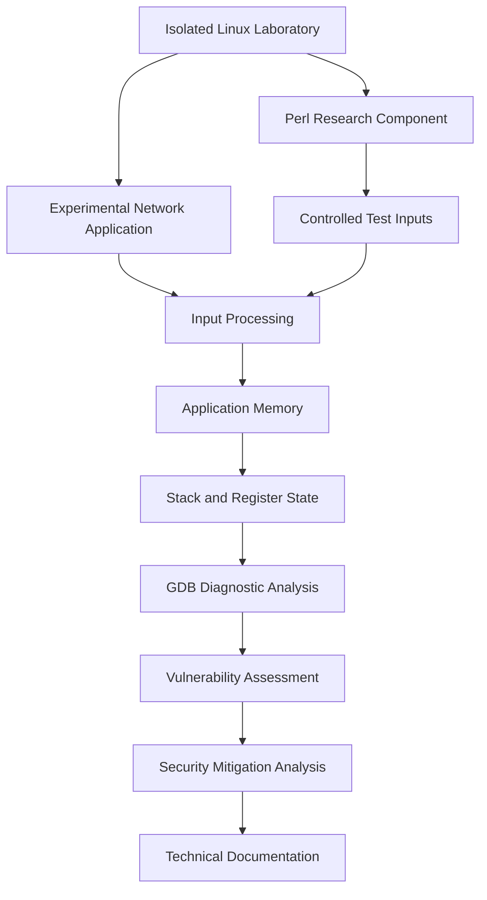

# Shellcode Injection and Buffer Overflow — Memory Safety Analysis


## Abstract

This project presents an experimental investigation of stack-based
memory vulnerabilities in native applications operating within an
x86-64 GNU/Linux environment.

The work examines buffer overflow behavior, stack frame organization,
program control-flow integrity, debugger-assisted vulnerability
analysis, and the security implications of insufficient memory
protection mechanisms.

The implementation combines analysis of a vulnerable C-based network
application with Perl-based experimental scripting and GNU Debugger
(GDB) instrumentation.

Originally developed as a Computer and Communication Systems Security
project at the Department of Computer Science and Engineering,
University of Ioannina.

---

## Table of Contents

- [Project Objectives](#project-objectives)
- [System Architecture](#system-architecture)
- [Core Capabilities](#core-capabilities)
- [Technical Implementation](#technical-implementation)
- [Experimental Environment](#experimental-environment)
- [Repository Structure](#repository-structure)
- [Validation Methodology](#validation-methodology)
- [Security Mitigations](#security-mitigations)
- [Project Status and Limitations](#project-status-and-limitations)
- [Development Roadmap](#development-roadmap)
- [Responsible Use](#responsible-use)
- [Technical References](#technical-references)
- [Contributing](#contributing)
- [Academic Attribution](#academic-attribution)
- [Author](#author)
- [License](#license)

---

## Project Objectives

The primary objectives of this project are to:

- Investigate stack-based memory vulnerabilities in native applications.
- Understand x86-64 stack organization and register behavior.
- Examine the relationship between input validation and memory safety.
- Investigate program control-flow integrity.
- Develop practical experience with debugger-assisted analysis.
- Examine network-facing application security.
- Understand the role of compiler and operating-system protections.
- Document experimental observations and security implications.

## System Architecture

The following diagram illustrates the conceptual experimental
analysis environment.



The architecture distinguishes application behavior, experimental
inputs, runtime inspection, vulnerability assessment, and defensive
security analysis.

## Core Capabilities

| Capability | Description |
|---|---|
| Memory vulnerability analysis | Investigation of stack-based buffer overflow conditions. |
| Stack inspection | Examination of stack frames and application memory organization. |
| Register analysis | Investigation of processor register behavior using GDB. |
| Control-flow analysis | Study of the security implications of corrupted execution state. |
| Network application analysis | Investigation of memory vulnerabilities in a TCP-based application. |
| Experimental scripting | Perl-based automation within the academic laboratory. |
| Security protection analysis | Investigation of compiler and operating-system memory protections. |
| Technical documentation | Recording of experimental observations and methodology. |

## Technical Implementation

### Memory Safety Analysis

The project investigates how insufficient input validation and
unsafe memory operations can affect the integrity of native
applications.

The analysis focuses on:

- Stack-allocated memory.
- Local variables and stack frames.
- Saved execution state.
- Buffer boundaries.
- Memory corruption.
- Program control-flow integrity.

### Debugger-Assisted Analysis

The GNU Debugger (GDB) is used to investigate application behavior
at runtime.

The analysis examines:

- Processor register state.
- Application memory organization.
- Stack frame behavior.
- Execution flow.
- Abnormal termination conditions.
- Observable effects of memory corruption.

### Network Application Security

The original academic experiment investigates a C-based network
application operating through TCP sockets.

The project explores the security implications of processing
externally supplied data within native applications, particularly
where memory boundaries and input lengths are not adequately
validated.

### Experimental Scripting

The repository contains a Perl-based research component developed
for the original academic experiment.

The component is specific to the original laboratory configuration
and is not presented as a portable or general-purpose security tool.

### Security Protection Mechanisms

The academic experiment investigates application behavior under
deliberately weakened memory-protection conditions.

These conditions are relevant to understanding the importance of
modern defensive mechanisms, including:

- Stack canaries.
- Non-executable memory.
- Address Space Layout Randomization (ASLR).
- Position Independent Executables (PIE).
- Compiler-assisted memory safety checks.

The project does not establish the ability to bypass these
protections in modern production configurations.

## Experimental Environment

The original project documentation identifies the following
experimental environment.

| Component | Technology |
|---|---|
| Target operating system | Debian GNU/Linux |
| Kernel version | 6.12.57 |
| Processor architecture | x86-64 |
| Processor | AMD Ryzen 7 7730U |
| Application language | C |
| Scripting language | Perl |
| Compiler | GCC |
| Debugger | GNU Debugger (GDB) |
| Virtualization | VMware Workstation Pro |
| Network protocol | TCP |

The environment represents the original academic configuration.
Compatibility with other operating systems, compiler versions,
and hardware configurations has not been established.

## Repository Structure

```text
Shellcode-Injection-and-Buffer-Overflow-Analysis/
├── docs/
│   ├── assignment.pdf
│   └── documentation.pdf
├── src/
│   └── exploit.pl
├── .gitattributes
├── CHANGELOG.md
├── CODE_OF_CONDUCT.md
├── CONTRIBUTING.md
├── LICENSE
└── README.md
```

| Component | Responsibility |
|---|---|
| `docs/assignment.pdf` | Original academic project specification. |
| `docs/documentation.pdf` | Academic technical report. |
| `src/exploit.pl` | Experimental Perl research implementation. |
| `CHANGELOG.md` | Project change history. |
| `CONTRIBUTING.md` | Contribution guidelines. |
| `LICENSE` | Repository licensing information. |

The original C-based laboratory application is referenced in the
academic documentation but is not distributed as a separate source
file within the current repository.

## Validation Methodology

A structured evaluation should investigate the relationship between
application input, memory behavior, execution integrity, and
defensive security mechanisms.

### Functional Validation

| Validation Area | Objective |
|---|---|
| Input validation | Examine the handling of invalid and oversized input. |
| Memory boundaries | Identify potential out-of-bounds memory operations. |
| Stack integrity | Investigate abnormal changes in stack state. |
| Register state | Examine register behavior during runtime analysis. |
| Application stability | Evaluate behavior under unexpected input conditions. |
| Security protections | Assess the defensive role of memory protection mechanisms. |
| Reproducibility | Establish consistent observations within an isolated environment. |

### Defensive Evaluation

Further evaluation should investigate:

- Compiler warnings.
- Static source-code analysis.
- AddressSanitizer diagnostics.
- UndefinedBehaviorSanitizer diagnostics.
- Input-boundary regression testing.
- Application behavior with security protections enabled.
- Secure alternatives to unsafe memory operations.

These represent proposed validation procedures rather than a claim
that an automated security test suite has been established.

## Security Mitigations

The following mechanisms are relevant to reducing the risks
associated with stack-based memory vulnerabilities.

| Mitigation | Security Objective |
|---|---|
| Input validation | Reject invalid or excessive input. |
| Bounds checking | Prevent out-of-bounds memory access. |
| Stack canaries | Detect certain forms of stack corruption. |
| NX / DEP | Restrict execution of data-only memory regions. |
| ASLR | Randomize relevant memory locations. |
| PIE | Support executable address randomization. |
| AddressSanitizer | Detect memory safety violations during testing. |
| Static analysis | Identify potentially unsafe programming patterns. |
| Least privilege | Reduce the consequences of application compromise. |

These mechanisms are discussed as defensive engineering practices.
Their implementation and effectiveness within a hardened version
of the original application require further investigation.

## Project Status and Limitations

This project is an experimental academic software security
implementation.

The following limitations apply:

- The original experiment depends on a specific laboratory
  configuration.
- The original C-based application is not distributed separately.
- Reproducible execution across environments has not been established.
- Modern security protection configurations require further evaluation.
- Automated regression testing is not yet established.
- A hardened application implementation is not currently distributed.
- No production security or reliability guarantees are provided.

The project does not constitute a validated vulnerability scanner,
penetration testing framework, or production security solution.

## Development Roadmap

- [ ] Document the original laboratory dependencies.
- [ ] Establish an isolated and reproducible research environment.
- [ ] Review source-code provenance and licensing.
- [ ] Document memory-safety findings.
- [ ] Investigate compiler-assisted security protections.
- [ ] Establish static analysis procedures.
- [ ] Evaluate memory safety using sanitizers.
- [ ] Develop a hardened reference application.
- [ ] Establish defensive regression tests.
- [ ] Publish reproducible security validation results.

## Responsible Use

This repository is intended exclusively for academic research,
software security education, and authorized vulnerability analysis.

Experimental activities must be restricted to isolated systems
owned by the researcher or explicitly authorized for testing.

The repository is not intended for unauthorized access, testing
of third-party infrastructure, or production deployment.

## Technical References

### External Resources

- [GNU Debugger Documentation](https://sourceware.org/gdb/documentation/)
- [GCC Documentation](https://gcc.gnu.org/onlinedocs/)
- [Linux Kernel Documentation](https://docs.kernel.org/)
- [CWE-121 — Stack-based Buffer Overflow](https://cwe.mitre.org/data/definitions/121.html)
- [CWE-120 — Buffer Copy without Checking Size of Input](https://cwe.mitre.org/data/definitions/120.html)
- [SEI CERT C Coding Standard](https://wiki.sei.cmu.edu/confluence/display/c/SEI+CERT+C+Coding+Standard)

### Academic Documentation

- [Original Project Specification](docs/assignment.pdf)
- [Academic Technical Report](docs/documentation.pdf)

## Contributing

Contributions related to memory safety, defensive software
engineering, vulnerability documentation, secure coding,
testing, and technical documentation are welcome.

Please refer to the following documents before submitting changes:

- [Contribution Guidelines](CONTRIBUTING.md)
- [Code of Conduct](CODE_OF_CONDUCT.md)
- [Changelog](CHANGELOG.md)

## Academic Attribution

This project was originally developed as part of the
Security of Computer and Communication Systems coursework at:

**Department of Computer Science and Engineering**  
University of Ioannina  
Ioannina, Greece

**Course:** MYE007 — Security of Computer and Communication Systems

The original assignment and starter code were provided
by the course instructor.

The original instructor-provided text and comments are
preserved. Public redistribution of the instructor's
materials is permitted by the instructor, subject to
the preservation of this material.

The student's original contributions are distinguished
from instructor-provided and third-party materials.

## Author

| Author | Affiliation | GitHub |
|---|---|---|
| Christos-Grigorios Gkovaris | University of Ioannina | [@ChristosGkovaris](https://github.com/ChristosGkovaris) |

## License

The original contributions authored by Christos-Grigorios
Gkovaris are licensed under the [MIT License](LICENSE),
to the extent that he holds the applicable copyright.

The original academic starter code was provided as part
of the University of Ioannina coursework.

Third-party components and academic instructional materials
are not covered by the repository's MIT license and remain
subject to their respective copyright and licensing terms.

Redistribution permissions for the original academic
starter code and instructional materials remain unverified.